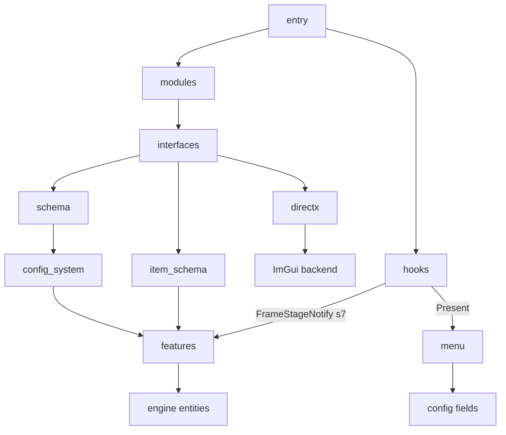
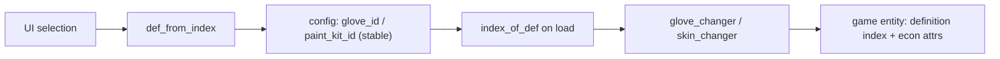
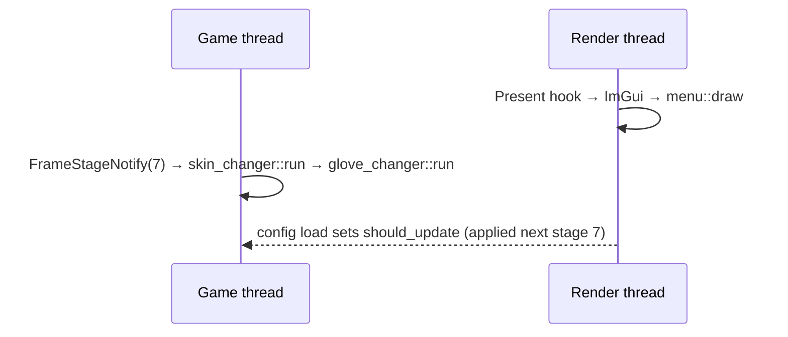

<div align="center" style="line-height: 0;">


<h1 style="margin: 0; padding: 0;">Counter-Strike 2 Skin Changer</h1>

</div>


> **Legacy laboratory module:** This native DLL and loader are separate from the standalone Acervo Companion in `/ui`. They alter CS2 client state, require a local `-insecure` session, and are not part of the companion workflow. The companion neither loads this DLL nor changes the game process. No VAC or matchmaking compatibility is claimed.


## Table of Contents
- [Preview](#preview)
- [Architecture](#architecture)
- [Identity & State Model](#identity--state-model)
- [Runtime Flow](#runtime-flow)
- [Features](#features)
- [Documentation Index](#documentation-index)
- [Project Structure](#project-structure)
- [Build](#build)
- [Dependencies](#dependencies)
- [Troubleshooting](#troubleshooting)
- [Development Guidelines](#development-guidelines)


## Preview

<table>
  <tr>
    <td align="center"><strong>Main Menu</strong></td>
    <td align="center"><strong>Knife Configuration</strong></td>
  </tr>
  <tr>
    <td>
      
    </td>
    <td>
      
    </td>
  </tr>

  <tr>
    <td align="center"><strong>Glove Configuration</strong></td>
    <td align="center"><strong>Skin Configuration</strong></td>
  </tr>
  <tr>
    <td>
      
    </td>
    <td>
      
    </td>
  </tr>

  <tr>
    <td align="center"><strong>Knife</strong></td>
    <td align="center"><strong>Glove</strong></td>
  </tr>
  <tr>
    <td>
      
    </td>
    <td>
      
    </td>
  </tr>

  <tr>
    <td align="center" colspan="2"><strong>Skin</strong></td>
  </tr>
  <tr>
    <td colspan="2" align="center">
      
    </td>
  </tr>
</table>


## Architecture

Independent subsystems coordinated by a single attach thread:

| Subsystem        | Responsibility                                        |
|------------------|-------------------------------------------------------|
| Core / entry     | DLL lifecycle, attach thread, ordered initialization  |
| Hooks            | MinHook + DXGI vtable hooks; per-frame dispatch        |
| Render (DirectX) | Swap-chain discovery, WndProc subclass, ImGui backend  |
| UI (menu)        | Theme, font atlas, tabbed three-panel control panel    |
| Config           | Pointer-registered JSON persistence + stable-id overlay|
| Features         | Knife / glove / weapon finish application; shared schema|
| Valve SDK        | Interface, module, schema and vtable bindings          |
| Utils            | Pattern scanning, Steam identity resolution            |



Detail: [`docs/architecture.md`](docs/architecture.md).

---

## Identity & State Model

Cosmetic selections have two identifier spaces:

| Space | Stable? | Used for |
|-------|---------|----------|
| Engine **definition index** / **paint-kit id** | Yes | persistence, runtime application |
| **List position** (UI row) | **No** | display only |

The UI panel and the runtime applier resolve a selection through the
*same* `def_from_index`, so they cannot disagree. Index 0 of the
knife/glove catalogs is a synthetic `(None)` sentinel. Configs persist
stable `*_id` keys and resolve them back to the *current* list position on
load; an unknown id degrades to `(None)` rather than a stale position.



This model and the desync bug it resolved are documented in full:
[`docs/glove_system.md`](docs/glove_system.md),
[`docs/skin_pipeline.md`](docs/skin_pipeline.md).

---

## Runtime Flow

1. `DllMain(DLL_PROCESS_ATTACH)` spawns the attach thread.
2. Ordered init: logger → modules → interfaces → item schema →
   skin changer → config (register + auto-load) → DirectX → hooks.
3. The DXGI `Present` hook drives the ImGui frame and renders the menu.
4. `FrameStageNotify` (stage 7) applies knife, weapon and glove state.
5. `VK_END` triggers shutdown: hooks removed, resources released, unload.



Detail: [`docs/runtime_flow.md`](docs/runtime_flow.md).

---

## Features

- **Knife changer** - visual model substitution, paint kit, wear and seed.
- **Glove changer** - model substitution, finish, wear, seed.
- **Skin changer** - per-weapon paint kit, wear and seed (defs 1–70).
- **Config system** - create, save, load, delete, rename, refresh, reset;
  on-disk JSON; stable-id persistence; auto-load of `default` at startup.

Cosmetic state changes apply automatically on the next safe engine frame;
no manual apply step.

---

## Documentation Index

| Document | Scope |
|----------|-------|
| [`docs/architecture.md`](docs/architecture.md) | Subsystems, relationships, threading |
| [`docs/runtime_flow.md`](docs/runtime_flow.md) | Attach, render/apply loops, shutdown |
| [`docs/config.md`](docs/config.md) | Persistence model, stable-id, backward compat |
| [`docs/glove_system.md`](docs/glove_system.md) | Glove identity pipeline + root-cause record |
| [`docs/skin_pipeline.md`](docs/skin_pipeline.md) | Weapon/knife skin pipeline |
| [`docs/hooks.md`](docs/hooks.md) | Hook set and dispatch |
| [`docs/ui.md`](docs/ui.md) | Menu construction, theme, panels |
| [`docs/project_structure.md`](docs/project_structure.md) | File responsibilities |
| [`docs/development.md`](docs/development.md) | Contribution rules |

---

## Project Structure

```
entry.cpp            DLL entry point and attach thread
hooks/               Hook installation and per-frame dispatch
directx/             Swap-chain discovery, WndProc, ImGui backend
menu/                Theme, fonts, UI render tree
sdk/config_system/   JSON configuration persistence
sdk/includes/        Third-party: ImGui, MinHook, FreeType, protobuf, json
features/            knife/glove/skin application + shared schema
valve/               Interface, module, schema, vtable bindings
utils/               Pattern scanning, Steam identity
docs/                Engineering documentation
assets/              README banner + screenshots (placeholders)
```

Detail: [`docs/project_structure.md`](docs/project_structure.md).

---

## Build

- **Toolchain:** Visual Studio 2022, MSVC v143, C++17, x64.
- **Configuration:** `Release|x64` (output: `x64/Release/CS.dll`).

```
msbuild vc.sln -t:Build -p:Configuration=Release -p:Platform=x64 -m
```

Define `VC_ITEM_DEBUG` (preprocessor) to enable identity-resolution
tracing in the glove/knife appliers; compiled out by default. All
third-party dependencies are vendored under `sdk/includes/`.

---

## Dependencies

| Library       | Use                                  |
|---------------|--------------------------------------|
| Dear ImGui    | UI rendering (DX11 + Win32 backends) |
| MinHook       | Inline function hooking              |
| FreeType      | Font rasterization for the atlas     |
| Protobuf      | Engine network/usercmd message types |
| nlohmann/json | Configuration serialization          |
| xorstr        | Compile-time string obfuscation      |

---

## Troubleshooting

| Symptom | Cause / Action |
|--------|----------------|
| Lists show "Loading…" | Economy schema not yet ready; retried per frame, resolves automatically. |
| No Steam name in status bar | Persona unresolved; cosmetic only. |
| Config not persisting | Verify write access to `C:\vc\configs\`. |
| No visual change after selection | Ensure the module is enabled and the player is alive. |
| Old config loads wrong glove/knife | Pre-`*_id` config: auto-migrated once; re-save to persist stable ids. |

---

## Development Guidelines

- Apply cosmetic state only from the `FrameStageNotify` stage-7 path; never
  from the render/Present path.
- Resolve selections through `def_from_index` / stable ids - never persist
  or compare list positions across frames.
- Persistent fields must be registered with the config system.
- Keep UI construction inside the reusable panel/list helpers.

See [`docs/development.md`](docs/development.md).
</content>
