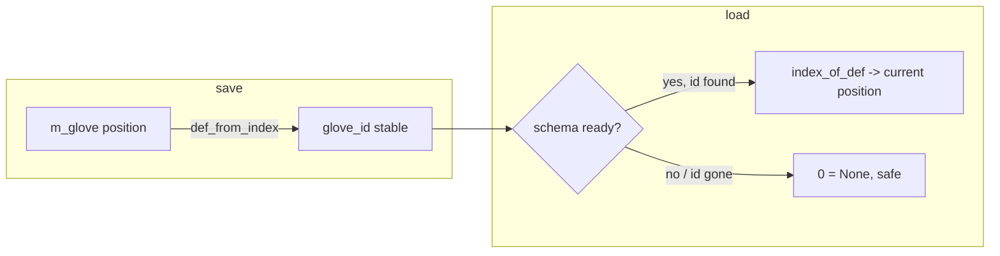

# Configuration System

`c_config_system` provides on-disk JSON persistence for all user state.

## Model

Persistence is **registration based**. At startup `setup_values`
registers every persistent field once, recording its address, category
and key:

- `push_item(&field, "category", "key", default)` for `bool`, `int`,
  `float` and `std::string`.
- `push_char_array(buffer, size, "category", "key")` for fixed buffers.

Registered categories:

| Category        | Fields                                                       |
|-----------------|--------------------------------------------------------------|
| `knife_changer` | enabled, knife, paint_kit, wear, seed, custom_name           |
| `glove_changer` | enabled, glove, paint_kit, wear, seed                        |
| `skin_changer`  | enabled, selected_weapon, and `weapon_<i>_*` for i in 0..99  |

Because save and load both iterate the same registry, the file schema and
runtime state remain consistent by construction.

## Storage

- Directory: `C:\vc\configs\` (created on startup if absent).
- Profiles: `<name>.cfg`, pretty-printed JSON, grouped by category.
- Default profile: `default` - auto-loaded on attach.

## Operations

| Operation | Behavior |
|-----------|----------|
| `save(name)`   | Serialize every registered field to `<name>.cfg`; refresh list. |
| `load(name)`   | Parse file; assign each present key to its field; flag features for re-apply. Missing keys keep current values. |
| `remove(name)` | Delete the file; refresh list. |
| `rename(a,b)`  | Rename the file; update selection if needed; refresh list. |
| `reset()`      | Restore every field to its registered default. |
| `refresh()`    | Rescan the directory into the profile list. |
| `auto_load()`  | Load `default.cfg` if present (startup). |
| `auto_save()`  | Persist to `default.cfg`. |

## Load → Apply Lifecycle

`load` only deserializes and sets the feature refresh flags
(`skin_changer.should_update`, `glove_changer.should_update`). The actual
cosmetic application is performed by the next `FrameStageNotify` stage-7
pass, which runs the knife/weapon and glove updates back-to-back in a
single engine-safe block. Deserialization (render thread) is therefore
fully decoupled from application (game thread); load is safe at any time,
including before a local player exists.

## Robustness

- Parse failures are caught; the in-memory state is left untouched.
- Absent files and absent keys are non-fatal (defaults / current values
  are retained).
- Character buffers are length-truncated on assignment.

## Stable-Identity Persistence

List positions (knife/glove/paint-kit row indices) are **presentation
order** - a hash-map walk, filtered, de-duplicated and re-sorted. They are
not stable across game economy updates and must never be the persisted
identity. See [`glove_system.md`](glove_system.md) for the full rationale
and the desync bug this caused.

`save` therefore writes an authoritative stable-id overlay alongside the
legacy raw indices:

| Legacy key (raw index) | Authoritative key (stable id) |
|------------------------|-------------------------------|
| `glove_changer.glove` / `paint_kit` | `glove_id` / `paint_kit_id` |
| `knife_changer.knife` / `paint_kit` | `knife_id` / `paint_kit_id` |
| `skin_changer.selected_weapon` | `selected_weapon_id` |
| `skin_changer.weapon_<i>_paint_kit` | `weapon_<i>_paint_kit_id` |

`load` resolves the stable ids back to *current* list positions via
`index_of_def` / `paint_kit_index_for_id`. If an id no longer exists, or
the schema is not yet ready, resolution falls back to `0` (the `(None)`
sentinel) - never a stale index whose meaning has changed.

## Backward Compatibility

- **Configs with `*_id` keys** (current/recent builds): resolved exactly,
  independent of list ordering and of the index-0 sentinel.
- **Old configs with only raw indices**: a precise one-time migration runs
  when the schema is ready - `idx > 0 ? idx + 1 : 0` to absorb the new
  `(None)` sentinel row (old "off" = 0 stays off), clamped to range.
- **Unparseable / partial configs**: caught; in-memory state untouched;
  absent keys keep current values; buffers length-truncated. No crash on
  any malformed or stale input.
