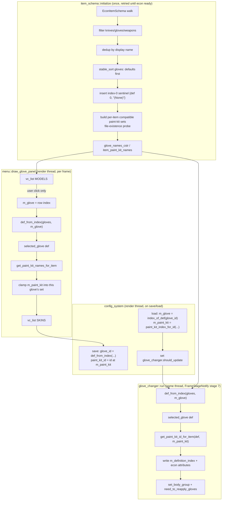
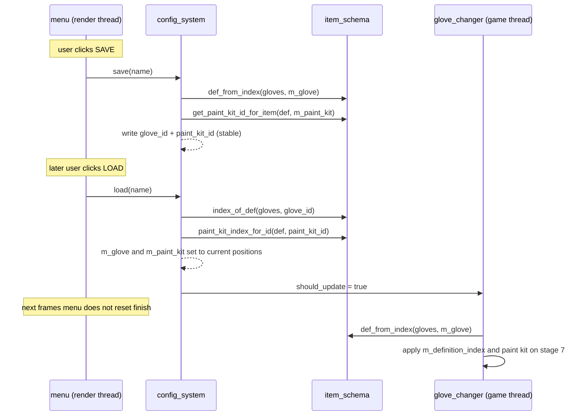

# Glove System

This document traces glove identity end-to-end, records the desync bug and
its root cause, and specifies the contract every stage now obeys. The same
model applies to knives; weapon skins are covered in
[`skin_pipeline.md`](skin_pipeline.md).

---

## 1. Identity model

There are three identifier spaces. Only the first is stable; the bug came
from persisting and resolving through the second.

| Space | Example | Stable? | Owner |
|-------|---------|---------|-------|
| **Engine definition index** | `5027` (Bloodhound) | Yes - Valve economy schema | `c_econ_item_definition::m_definition_index` |
| **Engine paint-kit id** | `10006` (`operation10_ct`) | Yes - Valve economy schema | `c_paint_kit::m_id` |
| **List position** | row `5` in the MODELS list | **No** | `c_item_schema::gloves` vector order |

List position is *presentation only*. It is produced by walking the econ
item map (hash-map order), filtering, de-duplicating by display name, then
re-ordering gloves so the defaults sort first. Any of those steps can move
an entry. **No persisted value and no runtime decision may key off list
position.** Configs persist the stable ids; everything resolves back to a
list position locally, at the point of use, against the *current* catalog.

---

## 2. End-to-end flow



The two resolve sites (UI panel and `glove_changer::run`) now call the
**identical** function - `c_item_schema::def_from_index(gloves, m_glove)`
- so the UI's idea of "the selected glove" and the runtime's can never
diverge.

---

## 3. Root cause (why the previous fix was insufficient)

The earlier change correctly added stable-id *serialization*. It did not
fix two defects that live entirely in the in-memory pipeline, so the
symptoms persisted.

### Defect A - the index-0 sentinel was never created

The whole codebase was written around a `(None)` row at list index 0:

- `glove_changer` / `process_knife` treat `m_glove == 0` / `m_knife == 0`
  as "no override".
- the paint-kit build loops skip `definition_index == 0`.
- `def_from_index` / `index_of_def` use slot 0 as the safe fallback.
- the readiness log prints `gloves.size() - 1`, `knives.size() - 1`.

But **no code ever inserted that row.** Consequently `gloves[0]` was a
*real* glove (after the default-first sort, "Default T Gloves"):

- selecting list row 0 set `m_glove = 0`, which the runtime interpreted as
  "off" - that glove was unselectable and silently dropped;
- `def_from_index(gloves, 0)` returned `0`, so the first real glove could
  never be saved (persisted as "none");
- every stable-id fallback that returned `0` landed on a row the runtime
  treated as off, *while the UI highlighted a real glove* - the exact
  "UI says X, game shows Y / nothing" desync.

This is a structural off-by-one between *what the engine/author assumed
index 0 meant* (none) and *what index 0 actually was* (a real glove).

### Defect B - stale `static` clobbered the loaded paint kit

`draw_glove_panel` / `draw_knife_panel` tracked the previous selection in a
**process-lifetime** `static int last_glove`:

```cpp
static int last_glove = 0;
uint16_t selected_glove = gloves[m_glove].def;   // computed from PREVIOUS frame's m_glove
if (last_glove != m_glove) {                      // fires for ANY change, incl. config load
    m_paint_kit = (glove_skins.size() > 1) ? 1 : 0;   // overwrites the just-loaded finish
    last_glove = m_glove;
}
...
vc_list(..., &m_glove);                           // m_glove only changes HERE, one frame later
```

Two failures fell out of this:

1. **Config load.** `config_system::load` resolved `glove_id` /
   `paint_kit_id` into `m_glove` + `m_paint_kit` correctly, then flagged a
   re-apply. But the menu's `static` still held the pre-load value; on the
   next frame the panel saw a change it did not cause and **reset the
   finish to the first non-default skin**, discarding the finish the
   config had just restored → *loaded glove came back with the wrong
   skin*.
2. **One-frame lag.** `selected_glove` was read at function entry from the
   *previous* frame's `m_glove`; the model list mutated `m_glove`
   afterwards. During rapid switching the SKINS panel and the paint-kit
   reset operated on the *previous* glove's id and list - *selecting one
   glove briefly applied another glove's finish*.

A and B together explain every reported symptom with no need to invoke a
cross-version catalog reorder.

---

## 4. The fix (contract per stage)

| Stage | File | Rule now enforced |
|-------|------|-------------------|
| Schema | `item_schema.cpp` | After dedup + sort, prepend `{0,"(None)",nullptr}` to `knives` and `gloves` (not weapons - they have no "off"). Readiness check moved *before* the insert so the inject-time retry still works. |
| UI | `menu.cpp` | No `static` selection tracking. Resolve `selected_*` via `def_from_index` **after** the model `vc_list`. Re-default the finish **only** when `vc_list` reports an active user click (`model_changed`), never on programmatic/config change. Clamp `m_paint_kit` into the resolved item's own set. |
| Config | `config_system.cpp` | `*_id` keys remain authoritative and are sentinel-agnostic. Added a precise legacy migration: configs with a raw `glove`/`knife` index but no `*_id` key shift `idx>0 ? idx+1 : 0` (old "off" stays off), clamped to range. |
| Runtime | `glove_changer.cpp`, `skin_changer.cpp` | Resolve via the same `def_from_index`; out-of-range/stale → def 0 → no-op (degrade to "none", never the wrong family). `get_paint_kit_id_for_item` only returns ids from the selected item's own compatibility set. |

Paint-kit compatibility is enforced structurally: a glove's set is built by
probing for `..._<glove>_<paintkit>_light_png.vtex_c`, so the set *is* the
valid combination list. An index outside it resolves to `0` (Default)
rather than indexing another family's vector.

### Verification trace

Build with `VC_ITEM_DEBUG` defined to log, every stage-7 apply:

```
[glove] idx=5 -> def=5027 | pk_idx=3 -> pk_id=10006 | model=models/.../bloodhound.vmdl
[knife] idx=7 -> def=515  | pk_idx=1 -> pk_id=38     | model=models/.../knife_karam.vmdl
```

`idx → def` and `pk_idx → pk_id` make any residual desync observable
directly. The macro is compiled out by default (silent release builds).

---


## 5. Config save/load sequence



Deserialization is on the render thread; application is deferred to the
game thread (stage 7). The menu no longer interferes between the two.

---

## 6. Verification matrix

| Case | Expected | Covered by |
|------|----------|------------|
| Select each glove family | UI highlight == applied model | A (sentinel), shared resolve |
| Rapid switching | No previous-glove finish bleed | B (post-list resolve) |
| Save then load same profile | Exact glove **and** finish restored | B (no reset on load) + stable ids |
| Default T / Default CT gloves | Selectable and applied | A (real gloves no longer collide with "off") |
| `(None)` row | No glove override | A (sentinel def 0) |
| Foreign/stale paint-kit index | Falls back to Default, no cross-family | clamp + compatibility set |
| Old config (raw index, no `*_id`) | Correct entry after +1 migration; never crash | config migration |
| Econ schema slow at inject | Lists fill in; no false "ready" | readiness check before sentinel |

---

## 7. Invariants (do not regress)

1. List position is never persisted and never compared across frames.
2. Index 0 of `knives`/`gloves` is always the `(None)` sentinel; weapons
   have none.
3. UI and runtime resolve selection through the *same* `def_from_index`.
4. A finish is re-defaulted only on an explicit user model click.
5. `*_id` config keys are authoritative; raw indices are legacy fallback
   only.
</content>
</invoke>
