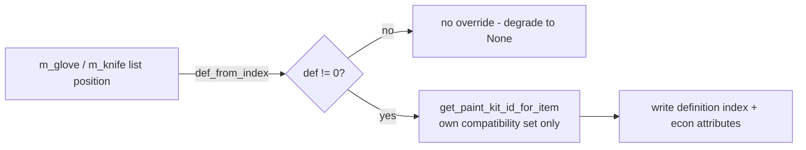

# Runtime Flow

## DLL Attach

```
DllMain(DLL_PROCESS_ATTACH)
  └─ InitMemAlloc()
  └─ DisableThreadLibraryCalls()
  └─ CreateThread(start_address)
```

`DllMain` returns immediately; all work runs on the attach thread.

## Initialization Sequence

`start_address` (guarded by a top-level try/catch):

1. `logger::initialize`
2. `modules::initialize` - resolve module bases
3. `interfaces::initialize` - resolve engine/client interfaces
4. `item_schema::initialize` - build the cosmetic catalog (retried later
   if the economy data is not yet ready)
5. `skin_changer::initialize`
6. `config_system::setup_values` - register persistent fields, create the
   config directory
7. `config_system::auto_load` - apply `default.cfg` if present
8. `directx::initialize` - resolve DXGI vtable addresses
9. `hooks::initialize` - install all hooks
10. Enter the terminate watch loop (`VK_END`)

If any step throws, a message box reports the error and the thread exits
cleanly.

## Render Loop (render thread)

```
Present hook
  └─ directx::start_frame        (one-time: device, RT, WndProc, ImGui)
  └─ directx::new_frame          (ImGui DX11 + Win32 + NewFrame)
  └─ menu::draw                  (schema retry, theme, window, panels)
  └─ directx::end_frame          (ImGui render)
  └─ original Present
```

The menu retries `item_schema::initialize` each frame until the catalog
is populated, so lists fill in automatically once the economy is ready.

## Application Loop (game thread)

```
FrameStageNotify(stage == 7)
  └─ skin_changer::run   → process_knife / process_weapon
  └─ glove_changer::run  → glove apply state machine
```

Both consume the `should_update` refresh flags. Knife, weapon and glove
state are applied in the same call, so a configuration load takes effect
atomically on the next frame. Event hooks (`FireEventClientSide`,
`LevelInit`) only set flags; they never apply directly.

### Selection resolution (identity-safe)

Each stage-7 applier resolves the persisted/selected state to a stable
engine definition index immediately before use - the *same* resolve the
menu uses, so UI and runtime cannot disagree:



A stale, reordered or out-of-range position resolves to definition `0`
(the `(None)` sentinel) and is skipped - it can never select the wrong
glove/knife family. Paint kits outside the resolved item's own set fall
back to `0` (Default). See [`glove_system.md`](glove_system.md).

## Shutdown Sequence

Triggered by `VK_END`; `destroy`:

1. Restore cursor visibility / input cursor state if the menu was open.
2. Unhook `Present`, `ResizeBuffers`, `CreateSwapChain`.
3. Brief yield to let in-flight render hooks drain.
4. Unhook `CreateMove`, `MouseInputEnabled`, `EnableCursor`,
   `FrameStageNotify`, `FireEventClientSide`, `LevelInit`.
5. Brief yield.
6. `directx::uninitialize` - restore WndProc, shut down ImGui, release
   D3D objects.
7. `MH_Uninitialize`.
8. `logger::shutdown`.
9. `FreeLibraryAndExitThread`.

The render hooks are removed before the code hooks so the ImGui pipeline
is quiesced before its backing resources are freed.
