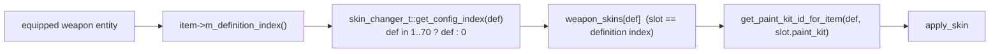
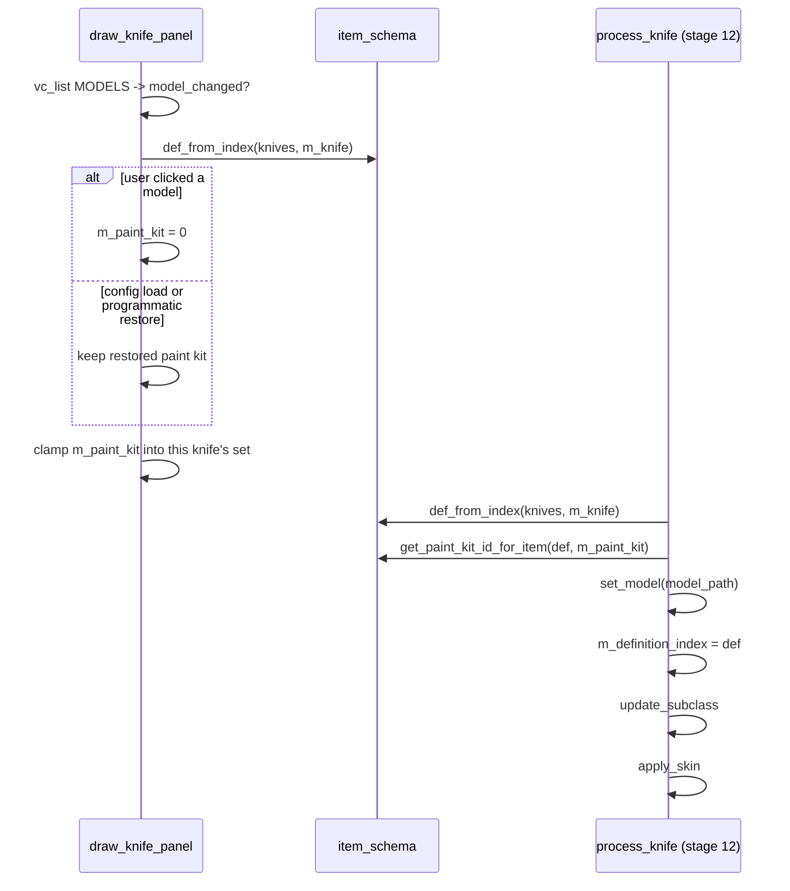
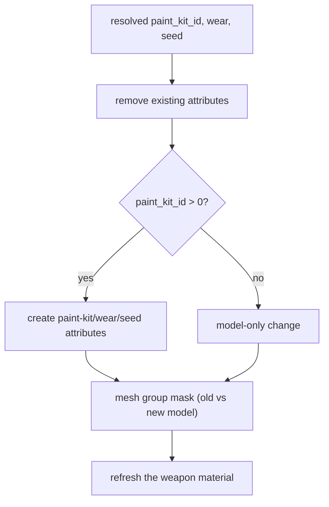

# Skin Pipeline

Companion to [`glove_system.md`](glove_system.md). Covers weapon finishes
and knife model/finish application in `skin_changer`. The identity model
(stable engine ids vs. unstable list positions) is identical; read the
glove doc first for the rationale.

---

## 1. Weapons

Weapon finishes were never index-fragile and were left unchanged. The
proof:

The applied finish is keyed by the **weapon's own definition index**, not
by the MODELS list cursor. `m_selected_weapon` is a pure UI cursor: it
only chooses *which* `weapon_skins[]` slot the panel edits; it never
participates in application. `weapon_skins[i]` maps 1:1 to definition
index `i`, and persistence writes `weapon_<i>_paint_kit_id` resolved
through the stable paint-kit id. There is no reorder-sensitive path, so no
"off" sentinel is needed or wanted for weapons (and none was added - the
readiness log prints `weapons.size()` with no `-1`).

**Invariant:** weapon application is a function of the live entity's
definition index only.

---

## 2. Knives

`process_knife` previously did `knives[m_knife].definition_index` and
`knives[m_knife].model_path` guarded only by a bounds check, and
`draw_knife_panel` carried the same stale `static int last_knife` reset.
Both were corrected to match the glove contract:

Knife specifics beyond the glove flow:

- Knives carry an explicit **model path** (`set_model`), unlike gloves
  whose model is engine-driven from the definition index + body group.
  `model_path` is read via the same bounds-checked index that produced the
  definition, so model and definition can never come from different rows.
- `update_subclass(selected_knife)` re-keys the weapon's subclass to the
  resolved definition - also fed by the single resolve.
- Sentinel applies: `knives[0]` is `(None)`; `m_knife == 0` ⇒ no override.

---

## 3. Econ attribute application (shared)

### Build 26598758

`process_weapon` and `process_knife` call `apply_skin` in
[`features/skin_changer/skin_changer.cpp`](../features/skin_changer/skin_changer.cpp).
It writes the paint kit, wear and seed, checks the engine's resolved paint kit,
and uses the weapon's native material refresh sequence. `run` repeats the
update when the equipped weapon's first-person model becomes available.
`acervo::report_finish` in [`menu/menu.cpp`](../menu/menu.cpp) reports whether
the request reached the material refresh. Inspect the item in hand to confirm
the result. Inventory icons and the kill feed follow the game's usual updates.

Both paths converge on `econ_item_attribute_manager`:

`paint_kit_id == 0` is the canonical "Default / no finish" value and is
safe at every stage - it removes attributes and leaves the base model.
This is the value every fallback (`def_from_index`, `index_of_def`,
`paint_kit_index_for_id`, the menu clamp) degrades to, so an invalid or
stale selection always produces a clean default rather than a foreign
finish.

---

## 4. Why this is robust across game updates

| Change in game | Effect | Why it is safe |
|----------------|--------|----------------|
| Econ map reordered | List positions move | Configs hold stable ids; resolved fresh each load |
| Glove/knife added or removed | List grows/shrinks | Resolution is by definition index, not position |
| Paint kit added | New entry in a set | Sets rebuilt from file-existence probe each init |
| Definition index retired | `index_of_def` misses | Falls back to `(None)` - no crash, no wrong family |
| Old config loaded | No `*_id` keys | One-time `+1` sentinel migration, then re-saved with ids |
</content>
